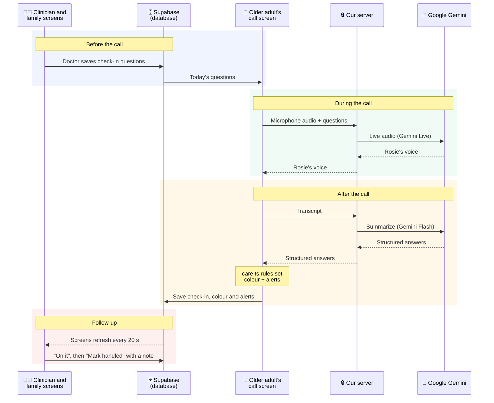

# homeBuddy 🏡

**Bringing the reassurance of a nursing home's daily check-in to older adults aging at home.**

Built for the **PointClickCare Challenge** at the **Women in Engineering (WiE) Hackathon 2026**, University of Waterloo.

> ⚠️ **Safety notice:** homeBuddy is a hackathon prototype. It is not a medical device and never diagnoses or gives treatment advice. The older adult's screen always says to call **911** in an emergency. All patient data shown here is fictional.

---

## 💡 The problem

Older adults living on their own often face slow-building health problems: missed meals, growing tiredness, dehydration, skipped medications. Nobody notices until they end in an emergency room visit.

In a nursing home, staff check on residents every day. At home, nobody does. Health portals don't fill the gap, because they expect older adults to log in, type and navigate complex screens.

**homeBuddy replaces the daily form and the nurse's phone call with a short, friendly voice call**, then passes what it hears to the clinician and family.

---

## 🔁 How it's used: doctor → older adult → doctor → family

### 1. The doctor sets up the check-in
On a patient's page (`/care/:patientId`), the clinician writes the questions for that older adult, e.g. *"Did you do your dialysis today?"* or *"How many glasses of water today?"*. For each one, they choose:
- **when to flag:** a yes/no answer, or a number above or below a limit;
- **when it turns red:** after how many flagged days in a row;
- **how often it's asked:** every day, every few days, or just once.

They can also update the care plan (e.g. a new medication time), and Rosie will tell the older adult about it on the next call.

> **In the code:** the questions are saved to the older adult's record in Supabase. Before each call, `callContext()` in `care.ts` turns them into the list of questions to ask that day.

### 2. The older adult just talks
The older adult opens `/senior` and taps one big button. **Rosie**, an AI voice companion, greets them and asks about sleep, meals, fluids, pain, mood, falls and medications, then the doctor's questions. If an answer is vague ("I think so"), she asks again in simpler words. No typing is needed.

> **In the code:** the browser streams microphone audio over a WebSocket to our server (`/api/live`), which relays it to **Google Gemini Live** and streams Rosie's voice back. The server adds the day's questions and keeps the Gemini API key secret.
>
> **Urgent words don't wait for the call to end.** While the older adult talks, the app checks each sentence for words like *"chest pain"*, *"fell"* or *"can't breathe"*. If it hears one, it sends a red alert to the care team and family right away, and tells the older adult they've been alerted.

### 3. The call is summarized and screened
When the call ends, the older adult sees a simple summary of what was said. Behind the scenes, the day is marked **🟢 green**, **🟡 yellow** or **🔴 red** (see [the rules](#-the-rules-green-yellow-red) below).

> **In the code:** a server function (`runSummary` in `checkin.functions.ts`) sends the transcript to **Gemini Flash**, which returns structured answers: for each question, the older adult's words and *yes / no / unclear*. The rules in `care.ts` then colour the day and create alerts, each with the reason and the older adult's own words.

### 4. The doctor follows up
The care dashboard (`/care`) lists every patient sorted **red → yellow → green**, with open alerts at the top and how long each has waited. Red means contact the patient today, and yellow means keep an eye on it. Each alert says why, e.g. *"Mood 2/5 (low) 3 days in a row"*, with a quote from the call.

Each alert moves through three stages:
1. **New:** the care team has been told.
2. **On it:** a clinician taps "On it", so the rest of the team (and the family) know someone is handling it.
3. **Handled:** the clinician taps "Mark handled" and **must write a note** on what they did, e.g. *"Called Margaret, booked a dialysis appointment for Friday."* The note stays attached to that alert, with who handled it and when. Handled alerts move to a **Handled** list on the dashboard, so there's a record of every follow-up.

The patient page also shows history charts for each question, so trends are easy to spot.

### 5. Family stay in the loop
Family members (`/family`) see today's colour, the latest summary and any alerts, in plain words. They also see each alert's follow-up as it happens: *"The care team has been told"* → *"Dr. Lee is on it"* → *"Resolved by Dr. Lee: Called Margaret, booked a dialysis appointment for Friday."* The family view is read-only.

> **In the code:** all three screens read the same record and refresh every 20 seconds, so a check-in on the older adult's phone appears on the doctor's laptop. The database's access rules, not the UI, decide who can see and change what.

---

## 🚦 The rules: green, yellow, red

Every check-in gets a colour. **The AI never decides the colour.** It only reports what the older adult said. Plain, tested code in [`src/lib/care.ts`](src/lib/care.ts) applies the rules, so the same answers always give the same result, and every flag can say exactly why it fired. 

| Colour | Meaning | What triggers it |
| --- | --- | --- |
| 🟢 **Green** | All good | Nothing flagged |
| 🟡 **Yellow** | Watch: the clinician monitors | Missed or unconfirmed medication, low mood (2/5 or less), under 5 h sleep, fewer than 2 meals, low fluids, pain 4–6/10, or an answer the clinician marked "flag if" |
| 🔴 **Red** | Act today: contact the patient | A fall, urgent words ("chest pain", "can't breathe", "dizzy"…), pain 7/10 or more, or **yellow that keeps happening** |

**Yellow becomes red when it repeats.** One bad night is something to watch. Three in a row means something is changing:
- the same built-in reason (e.g. low mood) **3 days in a row** turns red;
- each clinician question has its own "turns red after N times in a row" setting. Setting it to 1 makes it red right away (e.g. skipping dialysis even once).

**Who is told:**

| | Clinician | Family | Older adult |
| --- | --- | --- | --- |
| 🔴 Red | Top of the dashboard, with the reason and quote | Alert with the reason, in plain words | "In an emergency, call 911" is always on screen |
| 🟡 Yellow | Yellow badge and alert | Alert with the reason | Nothing extra |
| 🟢 Green | Green badge | Green status | Nothing extra |

Family only see an older adult's information while the older adult chooses to share it with them.

---

## 📸 Screenshots

**Clinician dashboard:** patients sorted by colour, with the alerts that need a response.


| Older adult: one button to start the call | Family: today's status and the follow-up |
| --- | --- |
|  |  |

<details>
<summary><b>Patient page</b> (clinician): question graphs, the older adult's questions, check-in rules, care plan and history</summary>


</details>

---

## 🏗️ Architecture



- **Before the call:** the doctor's questions are saved in Supabase, and the call screen loads them.
- **During the call:** audio streams through our server to Gemini Live, and Rosie's voice streams back. Our server sits in the middle so the Gemini key never reaches the browser.
- **After the call:** our server asks Gemini Flash to turn the transcript into structured answers. The rules in `care.ts` decide the colour and who gets an alert, and the result is saved.
- **Follow-up:** the clinician and family screens pick it up within 20 seconds, and the clinician's follow-up is saved back to the same record.

**Frontend:** designed in **Figma**, built with **TanStack Start** (React 19, TypeScript, Vite), **Tailwind CSS** and **Radix UI**. It uses the Atkinson Hyperlegible font, large text and high contrast for older eyes. Each role has its own pages under `src/routes/_authenticated/`.

**Backend:** **Supabase** stores the data and handles sign-in. Each older adult has one record, holding their questions, check-ins, alerts and care plan, read and written through `care-store.ts`. Family and clinicians link to an older adult by entering the invite code shown on the older adult's screen.

**Privacy is enforced by the database itself**, using Supabase row-level security (`supabase/migrations/`). Even someone who bypasses the app's screens gets the same answer:

| Who | Can see the older adult's record | Can change it |
| --- | --- | --- |
| The older adult | ✅ Always | ✅ Yes |
| Their care team (linked by invite code) | ✅ Always | ✅ Yes: questions, care plan, alert follow-ups |
| Family (linked by invite code) | ✅ Only while the older adult has sharing turned on for them | ❌ Never |
| Anyone else | ❌ No | ❌ No |

Each account's role (older adult, family or care team) is chosen once at signup. Users can't change it afterwards, so a family member can't make themselves a clinician.

**AI:** **Google Gemini** runs the voice call and writes the summary. Both calls go through our server, so the API key stays secret. The AI only reports what was said: the colour always comes from the tested rules in `care.ts`.

### Tech stack

| Layer | Tools |
| --- | --- |
| Design | Figma |
| Frontend | TanStack Start v1 (React 19, TypeScript, Vite), Tailwind CSS v4, Radix UI, Recharts |
| Backend | Supabase (Postgres, row-level security, Auth), server functions and a WebSocket relay |
| AI | Google Gemini Live (voice), Gemini Flash (structured summaries) |
| Testing and CI | Vitest, React Testing Library, GitHub Actions |
| Built with | Lovable, Claude Code |

---

## 🚀 Running it yourself

**Bring your own backend.** Our hackathon demo ran on our team's own Supabase project and Gemini API key, and neither is shared:
- the **Gemini key** was never in this repo (it lived only in our hosting settings);
- the **Supabase address** in the code points to our project, so you'll swap in yours in step 2.

**You'll need:** [Bun](https://bun.sh) (a JavaScript runtime and package manager, like Node.js + npm), a free [Supabase](https://supabase.com) project, a [Gemini API key](https://aistudio.google.com/app/apikey), and Chrome (for microphone access).

**1. Download and install**
```bash
git clone https://github.com/winnie-c8/homeBuddy.git
cd homeBuddy
bun install
```

**2. Connect your own Supabase project**
1. **Create the tables and access rules.** In your Supabase dashboard, open the **SQL Editor** and run each file in `supabase/migrations/`, oldest first (they're named by date). If you use the [Supabase CLI](https://supabase.com/docs/guides/cli), run `supabase link` then `supabase db push` instead.
2. **Point the app at your project.** In **Project Settings → API**, copy your **Project URL** and **publishable key**. Paste them over the two values at the top of `src/integrations/supabase/client.ts`:
   ```ts
   const SUPABASE_URL = "https://YOUR-PROJECT.supabase.co";
   const SUPABASE_PUBLISHABLE_KEY = "sb_publishable_...";
   ```
   Update the matching values in `.env` too, so the two files agree.
3. **Allow sign-in from your computer.** In **Authentication → URL Configuration**, set the Site URL to `http://localhost:8080`. New Supabase projects ask users to confirm their email by default. Either click the link in the email, or turn off **Confirm email** under **Authentication → Providers → Email** while testing.

> The publishable key is designed to be public: the access rules above limit what it can do. **Never** put your Supabase *secret* (service role) key in the code.

**3. Add your Gemini key.** The server reads it from your terminal, so it never goes into a file in the repo. Run this in the same terminal you'll start the app from:
```bash
export GEMINI_API_KEY=your-gemini-api-key
```

**4. Run**
```bash
bun run dev     # open http://localhost:8080
bun run test    # unit tests
bun run build   # production build
```

**5. Try the full loop**
1. Sign up as an **older adult** (the "I'm a senior" option) and note the invite code on your screen.
2. In a private window, sign up as **care team** and enter the code. Add a question with a "flag if" rule.
3. In another private window, sign up as **family** and enter the code. Sharing starts on, and the older adult can turn it off at any time.
4. As the older adult, start a check-in and talk to Rosie. Watch the result appear on the other two screens.

> Note: some decorative background images are hosted by Lovable, the tool we built with, so they won't load in your copy. The app works without them.

### Project layout

```
src/
  routes/_authenticated/  older adult (senior.tsx), care (clinician) and family pages
  hooks/use-live-voice.ts browser side of the voice call
  lib/
    care.ts               green / yellow / red rules and alert routing (+ tests)
    care-store.ts         reads and writes each older adult's record in Supabase
    checkin.functions.ts  AI call summary (server)
    live-relay.server.ts  voice relay to Gemini Live (server)
    auth.ts               roles and page access
supabase/migrations/      database tables and access rules
docs/                     our hackathon plan (BRIEF.md) and user flows (FLOWS.md)
```

---

## 👩‍💻 Team

Built in 7 hours by:
- **Winnie Chen** ([@winnie-c8](https://github.com/winnie-c8))
- **Kaitlyn Chan** ([@kaitlynlaichan](https://github.com/kaitlynlaichan))
- **Caitlin Lim** ([@clim08-source](https://github.com/clim08-source))
