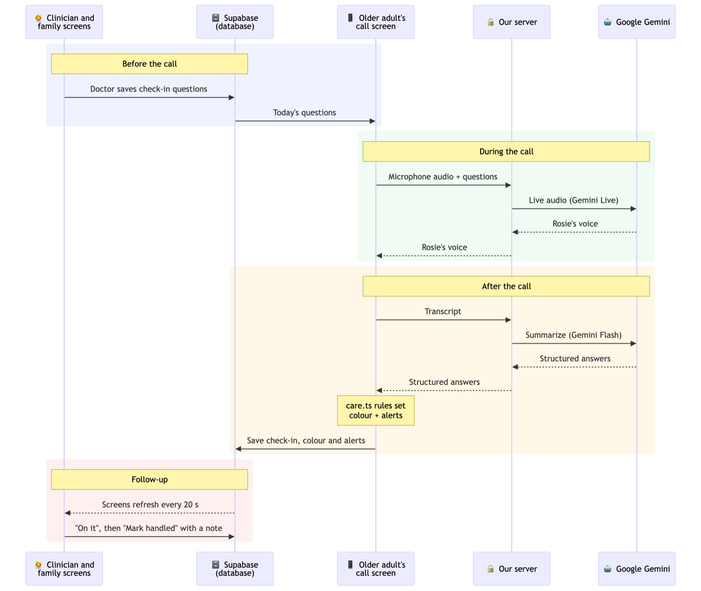

# homeBuddy 🏡

**Bringing the reassurance of a nursing home's daily check-in to older adults aging at home.**

Built for the **PointClickCare Challenge** at the **Women in Engineering (WiE) Hackathon 2026**, University of Waterloo.

> ⚠️ homeBuddy is a hackathon prototype, not a medical device. It never diagnoses or gives treatment advice, and the older adult's screen always says to call 911 in an emergency. All patient data shown here is fictional.

## The problem

Older adults living on their own often face health problems that build slowly: missed meals, growing tiredness, dehydration, skipped medications. Nobody notices until it ends in an emergency room visit.

In a nursing home, staff check on residents every day. At home, nobody does, and health portals don't fill the gap because they expect older adults to log in, type and find their way around complex screens.

homeBuddy replaces the daily form and the nurse's phone call with a short, friendly voice call, and passes what it hears to the care team and family.

## The rules: green, yellow, red

After each daily check-in call, the day gets a colour that tells the care team how quickly to respond. The AI doesn't choose the colour. It only reports what the older adult said, and a fixed set of rules decides the colour from that, so the same answers always give the same result and every flag can explain why it was raised.

| Colour | Meaning | What causes it |
| --- | --- | --- |
| 🟢 Green | All good | Nothing flagged |
| 🟡 Yellow | Keep an eye on it | A missed or unconfirmed medication, low mood (2/5 or less), under 5 hours of sleep, fewer than 2 meals, not drinking enough water, pain of 4–6/10, or an answer the doctor asked to flag |
| 🔴 Red | Contact the patient today | A fall, urgent words like "chest pain" or "can't breathe", pain of 7/10 or more, or a yellow that keeps coming back |

A yellow that repeats turns red. One bad night is worth watching, but three in a row suggests something is changing. The same reason (low mood, say) three days in a row turns the day red. For their own questions, the doctor decides how many flagged answers in a row it takes. Setting it to 1 makes a single flagged answer red straight away, which suits something like a skipped dialysis session.

Here's who hears about each colour:

| | Doctor | Family | Older adult |
| --- | --- | --- | --- |
| 🔴 Red | At the top of the dashboard, with the reason | An alert explaining what happened | Always sees "In an emergency, call 911" on screen |
| 🟡 Yellow | A yellow badge and an alert | An alert explaining what happened | Nothing extra |
| 🟢 Green | A green badge | A green status | Nothing extra |

## How it's used

The day follows a loop: the doctor sets the check-in, the older adult talks, the doctor follows up, and family can see all of it.

### 1. The doctor sets up the check-in

On each patient's page, the doctor writes the questions they want asked, like *"Did you do your dialysis today?"* or *"How many glasses of water did you drink?"*. For each question they decide which answer should be flagged (a yes, a no, or a number above or below a limit), how many flagged days in a row should turn it red, and how often to ask it: every day, every few days, or just once.

The doctor can also update the care plan, for example moving a medication to lunchtime. Rosie explains the change on the next call.

### 2. The older adult talks to Rosie

The older adult taps one big button and **Rosie**, an AI voice companion, starts a friendly conversation. She asks about sleep, meals, drinks, pain, mood, falls and medications, then the doctor's questions. If an answer is vague ("I think so"), she asks again in simpler words. Nothing needs to be typed.

At the end, Rosie asks if there's anything they'd like to ask their care team. The question goes to the doctor, and Rosie passes on the doctor's answer during the next call.

Urgent words don't wait for the call to end. If the older adult says something like "I fell" or "my chest hurts", the app sends a red alert to the care team and family right away.

### 3. The call is summarized and coloured

When the call ends, the older adult sees a simple summary of what they said. Behind the scenes, the AI turns the conversation into an answer for each question (yes, no or unclear, plus the older adult's own words), and the rules above decide the colour and who gets an alert.

### 4. The doctor follows up

The dashboard lists every patient, red first, then yellow, then green, with open alerts at the top showing how long each has been waiting. Every alert says why it was raised, for example *"Mood 2/5 (low) 3 days in a row"*, and where it can, quotes what the older adult said.

When a doctor takes an alert, they tap **On it**, so the rest of the team and the family know someone is handling it. When it's dealt with, they tap **Mark handled** and have to write a note on what they did, such as *"Called Margaret, booked a dialysis appointment for Friday."* That note stays with the alert, along with who handled it and when, so every follow-up is on record.

On each patient's page, the doctor also answers the older adult's questions and can look through charts of past answers to spot trends.

### 5. Family remains informed

Family members see today's colour, the latest summary and any alerts in plain language. They can also follow each alert's progress, from *"The care team has been told"* to *"Dr. Lee is on it"* to *"Resolved by Dr. Lee: Called Margaret, booked a dialysis appointment for Friday."* The family view is read-only, and the older adult can stop sharing with family at any time.

All three screens update every 20 seconds, so a check-in on the older adult's phone shows up on the doctor's laptop within moments.

## Screenshots

**Doctor's dashboard.** Margaret is red because she missed dialysis. Clarissa is yellow because she's not drinking enough water.


<table>
  <tr>
    <th>Older adult: one button to start the call</th>
    <th>Family: today's status and the follow-up</th>
  </tr>
  <tr>
    <td align="center"></td>
    <td align="center"></td>
  </tr>
</table>

<details>
<summary><b>Patient page</b> (click to open): answer charts, the older adult's questions for the doctor, check-in questions, care plan and history</summary>


</details>

## How it's built



The diagram follows one check-in from start to finish. Before the call, the older adult's screen loads the doctor's questions from the database. During the call, audio streams through our server to Google's Gemini Live, which speaks as Rosie. Afterwards, our server asks a second Gemini model to turn the transcript into structured answers. The rules then set the colour and alerts, the result is saved, and the doctor's and family's screens pick it up. Every request to Gemini goes through our server rather than the browser, which keeps the API key private.

| Part | What it does | Built with |
| --- | --- | --- |
| Design | The look of all three screens, with large text, high contrast and an easy-to-read font for older eyes | Figma, Atkinson Hyperlegible |
| Frontend | The older adult's, doctor's and family's screens | TanStack Start (React 19, TypeScript, Vite), Tailwind CSS, Radix UI, Recharts |
| Voice call | Streams the conversation between the browser and Gemini | A WebSocket relay on our server, Google Gemini Live |
| Call summary | Turns the transcript into an answer for each question | A server function, Google Gemini Flash |
| Rules | Decide green, yellow or red, and who gets an alert | TypeScript, with unit tests ([`care.ts`](src/lib/care.ts)) |
| Backend | Stores patients, check-ins and alerts, and handles sign-in for the three kinds of account | Supabase (Postgres and Auth) |
| Checks | Lint, tests and a build run on every push | Vitest, GitHub Actions |
| Built with | AI tools we used to build quickly as a team | Lovable, Claude Code |

## Running it yourself

To run your own copy, you'll need [Bun](https://bun.sh) installed, a free [Supabase](https://supabase.com) project and a [Gemini API key](https://aistudio.google.com/app/apikey). Use Chrome so Rosie can hear you through the microphone. The steps below show where everything goes.

**1. Download and install**
```bash
git clone https://github.com/winnie-c8/homeBuddy.git
cd homeBuddy
bun install
```

**2. Connect your Supabase project**
1. In your Supabase dashboard, open the **SQL Editor** and run each file in `supabase/migrations/`, oldest first (they're named by date). This creates the tables and access rules. If you use the [Supabase CLI](https://supabase.com/docs/guides/cli), `supabase link` then `supabase db push` does the same.
2. Copy your **Project URL** and **publishable key** (both are under **Project Settings**, or the **Connect** button at the top of the dashboard), and paste them over the two values at the top of `src/integrations/supabase/client.ts`:
   ```ts
   const SUPABASE_URL = "https://YOUR-PROJECT.supabase.co";
   const SUPABASE_PUBLISHABLE_KEY = "sb_publishable_...";
   ```
   Update the matching values in `.env` as well, so the two files agree.
3. Under **Authentication → URL Configuration**, set the Site URL to `http://localhost:8080`. New Supabase projects ask people to confirm their email by default, so either click the link in the email or turn off **Confirm email** in the Email sign-in settings while you test.

The publishable key is designed to be public, so it's fine in the code. Never put your Supabase *secret* key there.

**3. Add your Gemini key.** The server reads it from your terminal, so it never ends up in a file. Run this in the same terminal you'll start the app from:
```bash
export GEMINI_API_KEY=your-gemini-api-key
```

**4. Run it**
```bash
bun run dev     # then open http://localhost:8080
bun run test    # run the tests
```

**5. Try the full loop**
1. Sign up as an older adult (the "I'm a senior" option) and note the invite code on the screen.
2. In a private window, sign up as care team and enter the code. Add a question with a flag rule.
3. In another private window, sign up as family and enter the code.
4. Back as the older adult, start a check-in and talk to Rosie, then watch the result appear on the other two screens.

## Team

Built by:
- **Winnie Chen** ([@winnie-c8](https://github.com/winnie-c8))
- **Kaitlyn Chan** ([@kaitlynlaichan](https://github.com/kaitlynlaichan))
- **Caitlin Lim** ([@clim08-source](https://github.com/clim08-source))
