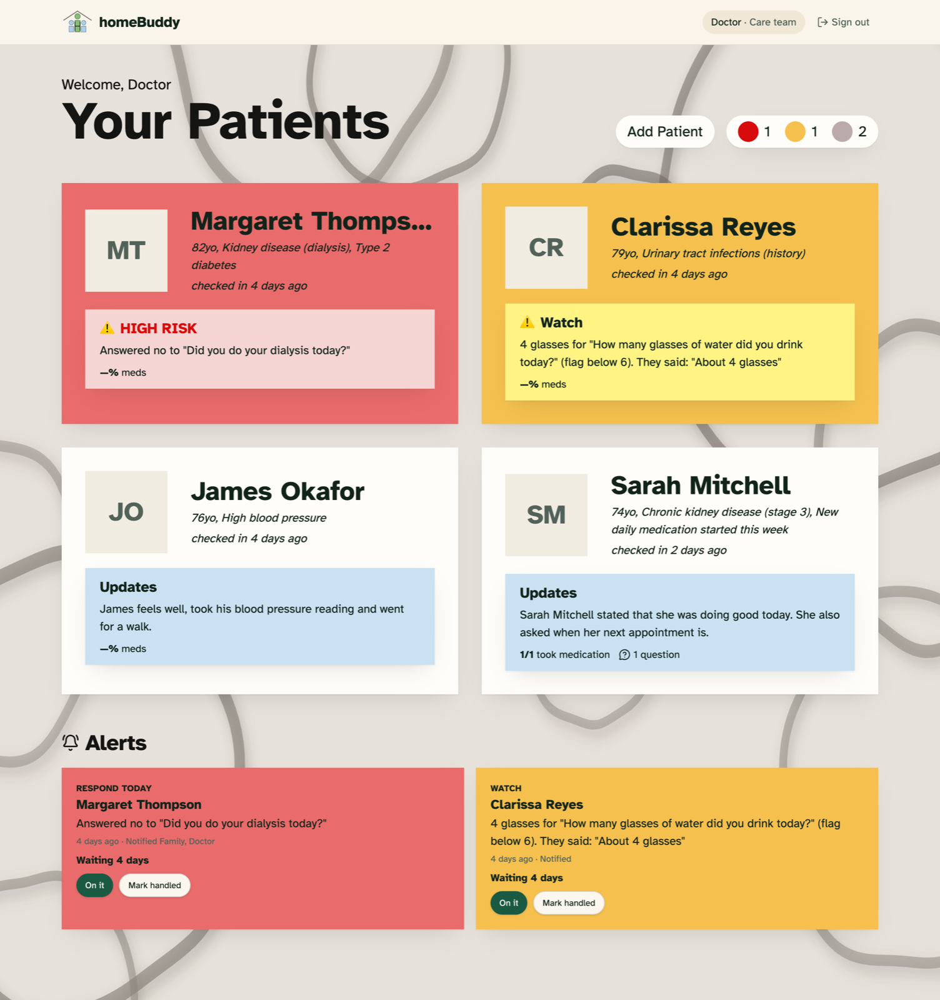
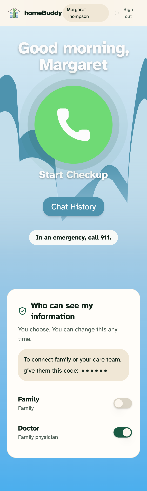
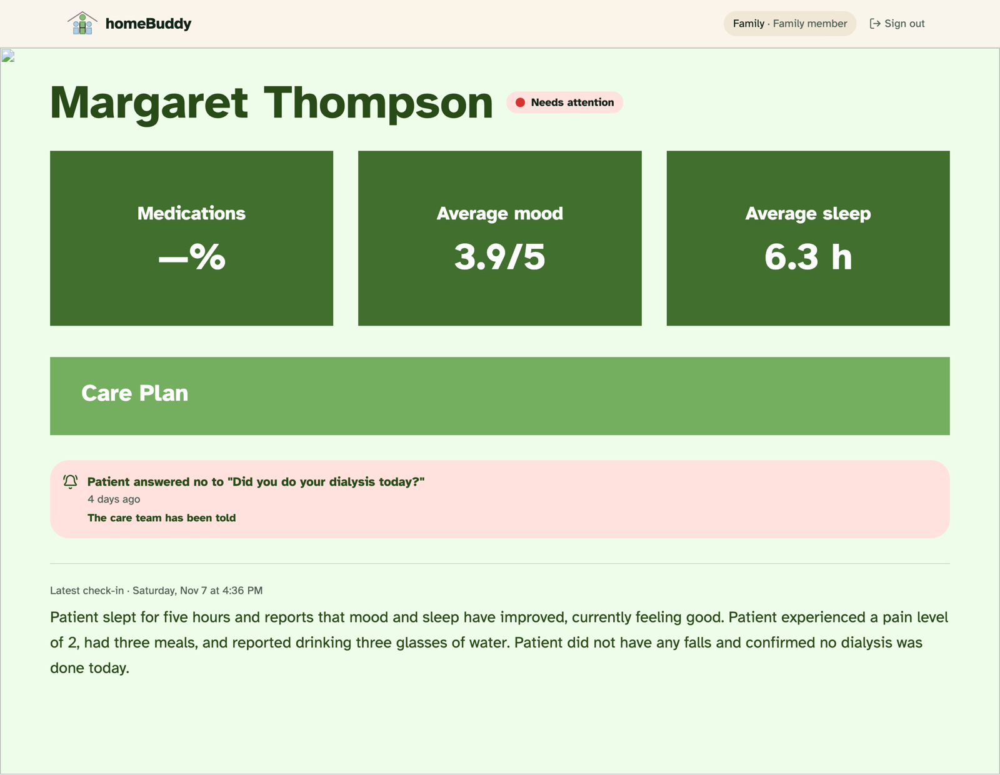
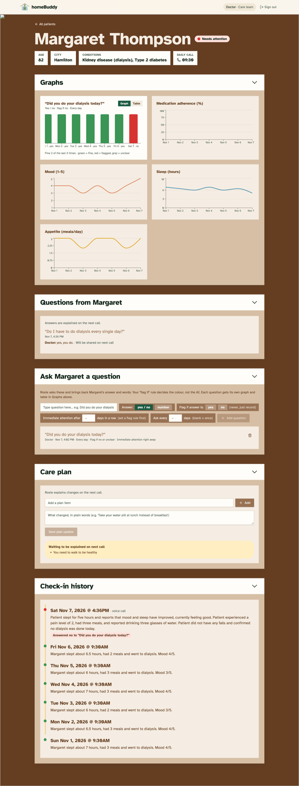

# homeBuddy 🏡

**Bringing the reassurance of a nursing home's daily check-in to seniors aging at home.**

Built in one day for the **PointClickCare Challenge** at the **Women in Engineering (WiE) Hackathon 2026**, University of Waterloo.

> ⚠️ **Safety notice:** homeBuddy is a hackathon prototype. It is not a medical device and never diagnoses or gives treatment advice. The senior's screen always says to call **911** in an emergency. All patient data shown here is fictional.

### Screenshots

**Clinician dashboard:** patients sorted by colour, with the alerts that need a response.



| Senior: one button to start the call | Family: today's status and the follow-up |
| --- | --- |
|  |  |

<details>
<summary><b>Patient page</b> (clinician): question graphs, the senior's questions, check-in rules, care plan and history</summary>



</details>

---

## 💡 The problem

Seniors living on their own often face slow-building health problems: missed meals, growing tiredness, dehydration, skipped medications. Nobody notices until they end in an emergency room visit.

In a nursing home, staff check on residents every day. At home, nobody does. Health portals don't fill the gap, because they expect seniors to log in, type and navigate complex screens.

**homeBuddy replaces the daily form and the nurse's phone call with a short, friendly voice call**, then passes what it hears to the clinician and family.

---

## 🚦 The rules: green, yellow, red

Every check-in gets a colour. **The AI never decides the colour.** It only reports what the senior said. Plain, tested code in [`src/lib/care.ts`](src/lib/care.ts) applies the rules, so the same answers always give the same result, and every flag can say exactly why it fired.

| Colour | Meaning | What triggers it |
| --- | --- | --- |
| 🟢 **Green** | All good | Nothing flagged |
| 🟡 **Yellow** | Watch: the clinician monitors | Missed or unconfirmed medication, low mood (2/5 or less), under 5 h sleep, fewer than 2 meals, low fluids, pain 4–6/10, or an answer the clinician marked "flag if" |
| 🔴 **Red** | Act today: contact the patient | No check-in, a fall, urgent words ("chest pain", "can't breathe", "dizzy"…), pain 7/10 or more, or **yellow that keeps happening** |

**Yellow becomes red when it repeats.** One bad night is something to watch. Three in a row means something is changing:
- the same built-in reason (e.g. low mood) **3 days in a row** turns red;
- each clinician question has its own "turns red after N times in a row" setting. Setting it to 1 makes it red right away (e.g. skipping dialysis even once).

**Who is told:**

| | Clinician | Family | Senior |
| --- | --- | --- | --- |
| 🔴 Red | Top of the dashboard, with the reason and quote | Alert with the reason, in plain words | Screen says call 911 |
| 🟡 Yellow | Yellow badge and alert | Alert with the reason | Nothing extra |
| 🟢 Green | Green badge | Green status | Nothing extra |

Family only see a senior's information while the senior chooses to share it with them.

---

## 🔁 How it's used: doctor → senior → doctor → family

### 1. The doctor sets up the check-in
On a patient's page (`/care/:patientId`), the clinician writes the questions for that senior, e.g. *"Did you do your dialysis today?"* or *"How many glasses of water today?"*. For each one, they choose:
- **when to flag:** a yes/no answer, or a number above or below a limit;
- **when it turns red:** after how many flagged days in a row;
- **how often:** every day, every few days, or just once.

They can also update the care plan (e.g. a new medication time), and Rosie will tell the senior about it on the next call.

> **In the code:** the questions are saved to the senior's record in Supabase. Before each call, `callContext()` in `care.ts` turns them into the list of things to ask today.

### 2. The senior just talks
The senior opens `/senior` and taps one big button. **Rosie**, an AI voice companion, greets them and asks about sleep, meals, fluids, pain, mood, falls and medications, then the doctor's questions. If an answer is vague ("I think so"), she asks again in simpler words. No typing is needed.

> **In the code:** the browser streams microphone audio over a WebSocket to our server (`/api/live`), which relays it to **Google Gemini Live** and streams Rosie's voice back. The server adds the day's questions and keeps the Gemini API key secret. If the senior says an urgent word mid-call, a red alert is raised straight away.

### 3. The call is summarized and screened
When the call ends, the senior sees a simple summary of what was said.

> **In the code:** a server function (`runSummary` in `checkin.functions.ts`) sends the transcript to **Gemini Flash**, which returns structured answers: for each question, the senior's words and *yes / no / unclear*. The rules in `care.ts` then colour the day and create alerts, each with the reason and the senior's own words.

### 4. The doctor follows up
The care dashboard (`/care`) lists every patient sorted **red → yellow → green**, with open alerts at the top and how long each has waited. Red means contact the patient today, and yellow means keep an eye on it. Each alert says why, e.g. *"Mood 2/5 (low) 3 days in a row"*, with a quote from the call.

The clinician marks an alert **"On it"**, then **"Resolved"**. An alert can't be closed without a note on what they did (e.g. *"Called Margaret, booked a visit for Friday"*). The patient page also shows history charts, so trends are easy to see.

### 5. Family stay in the loop
Family members (`/family`) see today's colour, the latest summary and any alerts, in plain words. They also see the follow-up: *"The care team has been told"* → *"Dr. Lee is on it"* → *"Resolved: …"*. The family view is read-only.

> **In the code:** all three screens read the same record and refresh every 20 seconds, so a check-in on the senior's phone appears on the doctor's laptop. The database's access rules, not the UI, decide who can see and change what.

---

## 🏗️ Architecture

```
 Senior's browser                 Our server                      Google Gemini
 ────────────────                 ──────────                      ─────────────
 Microphone  ───WebSocket──▶  /api/live relay  ───WebSocket──▶  Gemini Live (voice)
 Rosie's voice ◀────────────                   ◀──────────────
 Transcript  ──────────────▶  runSummary       ──────────────▶  Gemini Flash (summary)
                                    │
                         care.ts rules: green / yellow / red + alerts
                                    │
                                    ▼
                     Supabase (Postgres + Auth, row-level security)
                                    │
                     Clinician and family screens (refresh every 20 s)
```

**Frontend**: designed in **Figma**, built with **TanStack Start** (React 19, TypeScript, Vite), **Tailwind CSS** and **Radix UI**. It uses the Atkinson Hyperlegible font, large text and high contrast for older eyes. Each role has its own pages under `src/routes/_authenticated/`.

**Backend**: **Supabase** for the database and sign-in. Each senior has one record, read and written through `care-store.ts`. Family and clinicians join a senior with an invite code. Row-level security in `supabase/migrations/` enforces privacy in the database itself:
- family only see a senior while the senior shares with them, and can never edit;
- only the senior and their care team can change the record;
- roles (senior, family, care team) are set once at signup and can't be changed by the user.

**AI**: **Google Gemini** for the voice call and the summary. Both calls run on the server, so the API key never reaches the browser.

**Quality**: the rules are covered by unit tests ([`care.test.ts`](src/lib/care.test.ts)), and GitHub Actions runs lint, tests and a build on every push.

### Tech stack

| Layer | Tools |
| --- | --- |
| Design | Figma |
| Frontend | TanStack Start v1 (React 19, TypeScript, Vite), Tailwind CSS v4, Radix UI, Recharts |
| Backend | Supabase (Postgres, row-level security, Auth), server functions and a WebSocket relay |
| AI | Google Gemini Live (voice), Gemini Flash (structured summaries) |
| Testing and CI | Vitest, React Testing Library, GitHub Actions |
| Built with | Lovable, Claude Code |

---

## 🚀 Running it yourself

You'll need your **own** Supabase project and Gemini API key. This repo doesn't include working credentials for either.

**Prerequisites:** [Bun](https://bun.sh) (a JavaScript runtime and package manager, like Node.js + npm), a free [Supabase](https://supabase.com) project, a [Gemini API key](https://aistudio.google.com/app/apikey), and Chrome for microphone access.

**1. Install**
```bash
git clone https://github.com/winnie-c8/homeBuddy.git
cd homeBuddy
bun install
```

**2. Connect your Supabase project**
1. Create the tables and access rules by running the SQL files in `supabase/migrations/` in filename order. Paste each one into the Supabase **SQL Editor**, or use the [Supabase CLI](https://supabase.com/docs/guides/cli): `supabase link` then `supabase db push`.
2. From **Project Settings → API**, copy your **Project URL** and **publishable key** into `src/integrations/supabase/client.ts` and `.env`, replacing the existing values.

The publishable key is meant to be public, because the access rules limit what it can do. **Never** put the Supabase *secret* (service role) key in the code.

**3. Add your Gemini key**: keep it on the server and out of git.
```bash
export GEMINI_API_KEY=your-gemini-api-key
```

**4. Run**
```bash
bun run dev     # http://localhost:8080
bun run test    # unit tests
bun run build   # production build
```
Create three accounts (senior, family, care team). Copy the invite code from the senior's screen and enter it in the other two accounts to link them.

### Project layout

```
src/
  routes/_authenticated/  senior, care (clinician) and family pages
  hooks/use-live-voice.ts browser side of the voice call
  lib/
    care.ts               green / yellow / red rules and alert routing (+ tests)
    care-store.ts         reads and writes each senior's record in Supabase
    checkin.functions.ts  AI call summary (server)
    live-relay.server.ts  voice relay to Gemini Live (server)
    auth.ts               roles and page access
supabase/migrations/      database tables and access rules
docs/                     our hackathon plan (BRIEF.md) and user flows (FLOWS.md)
```

---

## 👩‍💻 Team

Built in 7 hours by:
- **Winnie Chen** ([@winnie-c8](https://github.com/winnie-c8))
- **Kaitlyn Chan** ([@kaitlynlaichan](https://github.com/kaitlynlaichan))
- **Caitlin Lim** ([@clim08-source](https://github.com/clim08-source))
